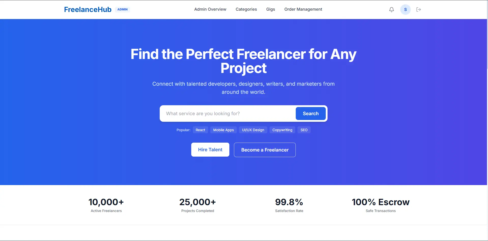

<div align="center">

# Ronit Tambe — Developer Portfolio

**Full Stack Developer · Pune, Maharashtra, India**

An Awwwards-inspired, high-performance personal developer portfolio built with semantic HTML5, modular CSS3, Vanilla ES6+ JavaScript, GreenSock Animation Platform (GSAP 3), ScrollTrigger, and the Lenis smooth-scroll engine.

[**Explore Live Website ↗**](https://ronit1161.github.io/ronit-portfolio/) · [**View Source Code**](https://github.com/ronit1161/ronit-portfolio) · [**Connect on LinkedIn**](https://www.linkedin.com/in/ronit-tambe-781a09204/)

<br />

[](https://ronit1161.github.io/ronit-portfolio/)
[](https://developer.mozilla.org/en-US/docs/Web/JavaScript)
[](https://greensock.com/gsap/)
[](https://github.com/darkroomengineering/lenis)
[](https://github.com/ronit1161/ronit-portfolio)
[](https://ronit1161.github.io/ronit-portfolio/)

</div>

---

## Table of Contents

- [Website Preview](#website-preview)
- [About the Portfolio](#about-the-portfolio)
- [Design Identity & Palette](#design-identity--palette)
- [Website Sections](#website-sections)
- [Key Features & Technical Highlights](#key-features--technical-highlights)
- [Tech Stack](#tech-stack)
- [Project Structure](#project-structure)
- [Run Locally](#run-locally)
- [Deployment Workflow](#deployment-workflow)
- [Contact & Social Links](#contact--social-links)

---

## Website Preview

The portfolio combines high-contrast editorial typography, interactive floating card physics, and pinned chapter storytelling. It presents real-world full-stack applications with responsive media fallbacks for mobile viewports:

<div align="center">

| Featured Project | Engineering Domain & Stack | Preview Interface |
| :--- | :--- | :---: |
| **Freelance Marketplace** | Enterprise talent platform with **Java 17, Spring Boot, Spring Security, JWT, MySQL, Hibernate, Docker, and React**. |  |
| **Food Ordering Web App** | Real-time commerce engine powered by **Next.js, React, MongoDB, NextAuth, Razorpay, and Tailwind CSS**. |  |
| **ExpenseWise Tracker** | Personal budget analytics application built with **React, Vite, Node.js, Express REST APIs, and MySQL**. |  |
| **Editorial Identity & Portrait** | Editorial hero layout with docked portrait card, stickers, and location metadata. |  |

</div>

> **Interactive Preview Note**: On desktop devices, hovering over any row in the **Selected Projects** directory launches an interactive, cursor-following floating preview card with velocity-based spring physics (`gsap.quickTo`). On mobile and touch devices, each project row expands gracefully into an inline visual accordion.

---

## About the Portfolio

### Purpose & Vision
This portfolio serves as both an introduction to **Ronit Tambe**'s work as a Full Stack Developer and a showcase of creative front-end engineering. Rather than utilizing pre-packaged templates, UI component libraries, or heavy client-side frameworks, the website was constructed from first principles to demonstrate mastery of modern web standards, animation physics, and typography.

### Design Philosophy: *Type as Architecture*
- **Editorial Brand Direction**: Influenced by contemporary design studios (notably Sebastián Martínez and Weirdo.is), the interface treats typography as monumental, physical mass.
- **Color Contrast & Staged Lighting**: Anchored by an eye-catching Radiant Vermilion (`#FE3C01`) hero canvas that recedes into stark monochrome surfaces (`#0B0B0C` and `#FFFFFF`), structured hairlines, and cobalt accents (`#4D5BFF`).
- **Zero-Build, Pure Web Runtime**: Eliminates bundler bloat, compilation steps, and node dependencies for the portfolio itself. Native browser ES execution ensures sub-second First Contentful Paint (FCP), zero dependency maintenance, and perpetual browser compatibility.

---

## Design Identity & Palette

The visual identity is defined by a curated editorial palette mapped to CSS Custom Properties in [`css/base.css`](file:///Users/naveen/Ronit/Projects/ronit-portfolio/css/base.css):

| Token Name | Hex Code | Visual Swatch | Applied Role |
| :--- | :--- | :---: | :--- |
| **Radiant Vermilion** | `#FE3C01` |  | Primary hero stage background, brand accents, and active state highlights |
| **Deep Carbon Black** | `#0B0B0C` |  | Primary typography, docked portrait card, and dark section canvas |
| **Architectural White** | `#FFFFFF` |  | Projects directory background, skills marquee canvas, and high-contrast text |
| **Gallery Off-White** | `#EFEDE8` |  | Transitional background tone for the pinned About Me section |
| **Cobalt Blue** | `#4D5BFF` |  | About section spinning stamp badge, focused outlines, and text gradients |
| **Hairline Dividers** | `rgba(0,0,0,0.1)` |  | Subtle architectural grid lines and row boundary separators |

---

## Website Sections

The portfolio is structured into five distinct narrative sections:

```
[01] HERO STAGE ───────► Radiant Vermilion canvas, kinetic typography reveals, avatar badge
         │
[02] EDITORIAL BRIDGE ──► Pinned scrubbed transition into the architecture statement
         │
[03] SELECTED WORK ─────► Interactive project directory with cursor-follower floating cards
         │
[04] TECHNICAL SKILLS ──► 3-track opposing horizontal marquee drifting with scroll velocity
         │
[05] ABOUT ME ──────────► Pinned chapter storytelling (Education / Experience / Focus) & theme handoff
         │
[06] CONTACT & FOOTER ──► Live IST clock, magnetic buttons, email copy tool & monumental wordmark
```

### 1. Hero Stage (`#hero`)
- Full-viewport Radiant Vermilion (`#FE3C01`) landing stage.
- Rhythmic masked headline entrance (*"HI, WELCOME HOME"*, *"IT'S ME — RONIT®"*).
- Kinetic avatar sticker rotating into place with an elastic back-eased spring (`back.out(2)`).
- Docked architectural portrait card containing author metadata, location, and quick profile links.
- Pinned scroll transition converting monumental display typography into an editorial bridge statement.

### 2. Selected Projects (`#work`)
- High-contrast editorial project directory detailing production-grade applications.
- Each row highlights the project title, system category, technology pill tags, and outbound repository/live demo links.
- Interactive floating card preview follower that tracks cursor velocity on desktop devices.

### 3. Technical Skills (`#skills`)
- Three-row horizontal marquee strips drifting leftward at staggered speeds:
  - **Row 1 (Backend Core)**: `01 Java — 02 Spring Boot — 03 Microservices`
  - **Row 2 (Web & Frontend)**: `04 React.js — 05 Next.js — 06 JavaScript`
  - **Row 3 (Data & Infra)**: `07 MySQL — 08 REST APIs — 09 Docker`
- Clean hairline grid lines and typographic indexing.

### 4. About Me (`#about`)
- Dynamic background handoff transitioning smoothly from dark (`#0B0B0C`) to gallery off-white (`#EFEDE8`).
- Masked character-by-character headline reveals (`chars()`).
- Progressive scroll-scrubbed bio reading fill (`words()`).
- Desktop pinned ledger (`≥ 900px`) locking the screen to cycle through **Education**, **Experience**, and **Focus** chapters with progress rail and ghost background typography.
- Continuous velocity-reactive marquee ticker accelerating during rapid scrolls.

### 5. Contact & Editorial Footer (`#contact`)
- Monumental concluding headline (*"Let's build something good."*) with scrubbed gradient fill.
- **Live Pune Clock**: Formatted in `Asia/Kolkata` standard time via `Intl.DateTimeFormat`, updating every 20 seconds.
- Interactive direct email display row with a one-click clipboard copying button (`copyEmail()`) and graceful textarea fallback.
- Magnetic action buttons pulling toward pointer coordinates (`gsap.quickTo`).
- Kinetic rolling social navigation links (GitHub, LinkedIn).
- Monumental scrubbed footer wordmark (`RONIT®`) with letters rising on scroll.

---

## Key Features & Technical Highlights

### 🎯 Dual-Element Precision Reticle Cursor
- Implemented in [`js/cursor.js`](file:///Users/naveen/Ronit/Projects/ronit-portfolio/js/cursor.js).
- Renders a zero-lag central tracking dot and an outer reticle ring that follows smoothly with a `0.22` linear interpolation factor (lerp).
- Automatically scales and shifts blend modes over interactive targets (`a`, `button`, `.domain-column`, `.email-display-wrap`).
- Bypassed entirely on touch devices and coarse pointers via `(hover: hover) and (pointer: fine)`.

### ⚡ Synchronized Smooth Scroll & Physics
- Utilizes the **Lenis** engine coupled directly to GSAP's central animation loop in [`js/about.js`](file:///Users/naveen/Ronit/Projects/ronit-portfolio/js/about.js):
  ```javascript
  lenis.on('scroll', ScrollTrigger.update);
  gsap.ticker.add((time) => {
    lenis.raf(time * 1000);
  });
  gsap.ticker.lagSmoothing(0);
  ```
- Guarantees 60fps jitter-free scroll coordination between native DOM scrolling and complex pinned triggers.

### 🧲 Spring-Based Cursor Follower
- Powered by `gsap.quickTo` springs inside [`js/animations.js`](file:///Users/naveen/Ronit/Projects/ronit-portfolio/js/animations.js):
  ```javascript
  const setX = gsap.quickTo(preview, 'x', { duration: 0.38, ease: 'power3.out' });
  const setY = gsap.quickTo(preview, 'y', { duration: 0.38, ease: 'power3.out' });
  ```
- Evaluates mouse delta velocity to apply real-time angular tilt, giving the floating card physical inertia.

### 🌐 Deep Parameter Routing
- Handled directly by [`js/main.js`](file:///Users/naveen/Ronit/Projects/ronit-portfolio/js/main.js):
  - `?scroll=<pixels>`: Instantly jumps to an exact scroll offset and refreshes ScrollTrigger.
  - `?goto=<elementId>`: Smoothly scrolls to a designated section anchor and recalibrates triggers.

### ♿ Universal Accessibility & Motion Safety
- Every animation subsystem checks `window.matchMedia('(prefers-reduced-motion: reduce)')`.
- Users with reduced-motion preferences receive a clean, readable layout without aggressive transforms.
- Built-in keyboard accessibility includes a skip-to-content link, ARIA landmarks, and keyboard drawer controls (`Escape` to close).

---

## Tech Stack

<div align="center">

| Layer | Technologies & Libraries | Purpose in Project |
| :--- | :--- | :--- |
| **Markup & Semantics** | Semantic HTML5 | Structured layout, ARIA landmarks, accessible navigation |
| **Styling & Tokens** | Modular CSS3, Custom Properties | Fluid typographic clamping, grid layout, theme transitions |
| **Programming Language** | Vanilla JavaScript (ES6+) | Modular lifecycle controller, DOM manipulation, utilities |
| **Animation Core** | GreenSock (GSAP 3.x) | High-performance timelines, physics springs, tween orchestration |
| **Scroll Engine** | GSAP ScrollTrigger | Viewport scrubbing, pinned chapter storytelling, parallax |
| **Smooth Scrolling** | Lenis Engine | Fluid inertia scrolling coupled to GSAP RAF ticker |
| **Brand Typography** | Aeonik (Black, Bold, Medium) | Self-hosted WOFF2 web fonts for editorial brand headers |
| **Web Typography** | Google Fonts (Anton, Instrument, Inter) | Body copy, monospace labels, and editorial accent text |
| **Hosting & CDN** | GitHub Pages (`.nojekyll`) | Global edge deployment with zero build step |

</div>

---

## Project Structure

```
ronit-portfolio/
├── .nojekyll                    # Instructs GitHub Pages to bypass Jekyll processing
├── favicon.svg                  # Brand SVG favicon
├── index.html                   # Master semantic HTML5 document
├── README.md                    # Project documentation
│
├── assets/                      # Self-hosted vendor scripts, brand fonts & media
│   ├── Aeonik-Black.woff2       # Primary editorial brand font (900 weight)
│   ├── Aeonik-Bold.woff2        # Primary editorial brand font (700 weight)
│   ├── Aeonik-Medium.woff2      # Primary editorial brand font (500 weight)
│   ├── expense tracker.webp     # Preview image: ExpenseWise Tracker application
│   ├── food ordering.webp       # Preview image: Food Ordering application
│   ├── freelance.webp           # Preview image: Freelance Marketplace application
│   ├── hero-character.webp      # Editorial illustration asset
│   ├── profile-pic.webp         # Author portrait asset (Ronit Tambe)
│   ├── resume-example.pdf       # Downloadable resume document
│   ├── gsap.min.js              # GSAP 3 core animation library
│   ├── ScrollTrigger.min.js     # GSAP ScrollTrigger plugin
│   └── lenis.min.js             # Lenis smooth-scrolling engine
│
├── css/                         # Modular CSS3 architecture
│   ├── base.css                 # Design system tokens, root variables, typography & resets
│   ├── hero.css                 # Sebastián Martínez inspired hero stage & transition bridge
│   ├── projects.css             # Editorial project directory & floating cursor preview
│   ├── skills.css               # Three-track horizontal marquee strips layout
│   ├── about.css                # About section, pinned chapters & color transitions
│   ├── contact.css              # Contact layout, email row, live clock & footer wordmark
│   ├── cursor.css               # Custom dual-element reticle cursor styling
│   ├── responsive.css           # Global media queries for tablet & mobile viewports
│   └── preloader.css            # Modular preloader stylesheet (dormant)
│
└── js/                          # Modular ES6+ JavaScript architecture
    ├── main.js                  # Master application controller, scrollspy & lifecycle engine
    ├── animations.js            # GSAP hero motion, pinned transition & cursor follower
    ├── about.js                 # Text split reveals, bio scrub, pinned chapters & theme handoff
    ├── contact.js               # Live IST clock, magnetic buttons, email copy & footer
    ├── cursor.js                # Custom reticle cursor physics & hover scaling
    ├── marquee.js               # Standalone draggable marquee utility (dormant)
    └── preloader.js             # Standalone monogram preloader utility (dormant)
```

---

## Run Locally

Because this project requires no compiler or package dependencies, running it locally is straightforward.

### 1. Clone the Repository
```bash
git clone https://github.com/ronit1161/ronit-portfolio.git
cd ronit-portfolio
```

### 2. Start a Local Static Server
To ensure smooth font loading, asset paths, and web worker compatibility, serve the directory with any local HTTP server:

#### Using Python 3 (Recommended)
```bash
python3 -m http.server 3000
```
Open **[http://localhost:3000](http://localhost:3000)** in your browser.

#### Using Node.js (`npx serve`)
```bash
npx serve . -p 3000
```
Open **[http://localhost:3000](http://localhost:3000)** in your browser.

#### Using PHP CLI
```bash
php -S localhost:3000
```
Open **[http://localhost:3000](http://localhost:3000)** in your browser.

#### Using VS Code Live Server
1. Install the **Live Server** extension in VS Code.
2. Open the project folder and click **"Go Live"** in the bottom status bar, or right-click `index.html` and choose **"Open with Live Server"**.

---

## Deployment Workflow

The portfolio is deployed to **GitHub Pages** with zero build configuration:

1. **GitHub Pages Engine**: Served directly from the `master` branch root (`/`).
2. **Jekyll Bypass (`.nojekyll`)**: The empty `.nojekyll` file in the root tells GitHub Pages not to process the site with Jekyll, ensuring that all directories and custom asset files serve cleanly without modification.
3. **Continuous Deployment**:
   ```bash
   git add .
   git commit -m "feat: enhance portfolio experience"
   git push origin master
   ```
   Any commit pushed to `master` automatically triggers the GitHub Pages deployment pipeline and updates the live site at **[ronit1161.github.io/ronit-portfolio](https://ronit1161.github.io/ronit-portfolio/)**.

---

## Contact & Social Links

Feel free to connect or explore more of my work:

- **Portfolio**: [ronit1161.github.io/ronit-portfolio](https://ronit1161.github.io/ronit-portfolio/)
- **GitHub**: [@ronit1161](https://github.com/ronit1161)
- **LinkedIn**: [Ronit Tambe](https://www.linkedin.com/in/ronit-tambe-781a09204/)
- **Direct Email**: [ronittambe116@gmail.com](mailto:ronittambe116@gmail.com)
- **Location**: Pune, Maharashtra, India

---

<div align="center">
<sub>Designed and engineered by <b>Ronit Tambe</b> · Focused on clean architecture, reliable database design, and intuitive user interfaces.</sub>
</div>
