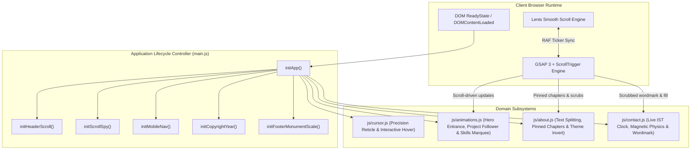
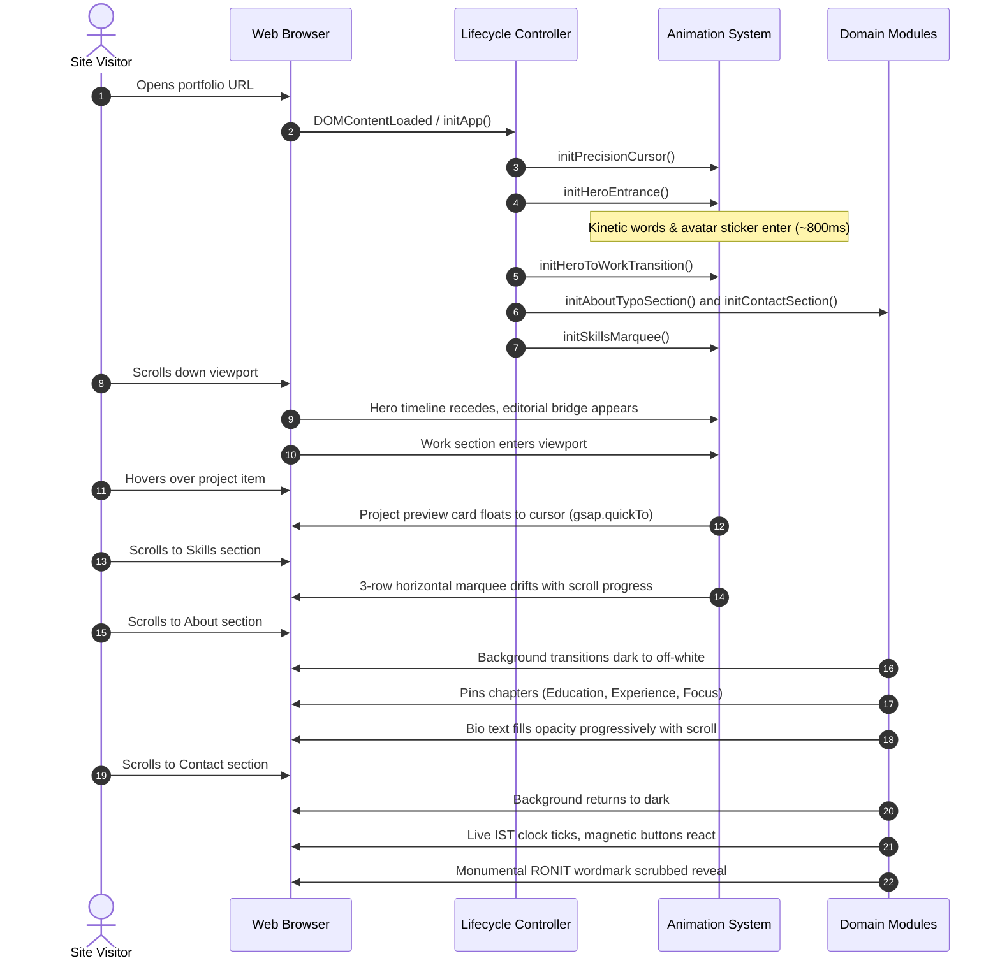
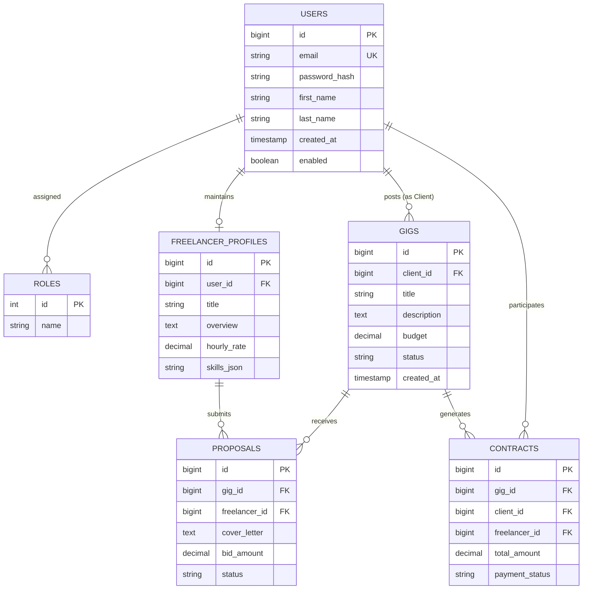

# Ronit Tambe — Full Stack Developer Portfolio

[](https://developer.mozilla.org/en-US/docs/Web/JavaScript)
[](https://developer.mozilla.org/en-US/docs/Web/CSS)
[](https://greensock.com/gsap/)
[](https://github.com/darkroomengineering/lenis)
[](https://github.com/ronit1161/ronit-portfolio)
[](https://ronit1161.github.io/ronit-portfolio/)

---

## Table of Contents

- [1. Project Title and Introduction](#1-project-title-and-introduction)
- [2. Project Overview](#2-project-overview)
- [3. Key Features](#3-key-features)
- [4. Screenshots / Application Preview](#4-screenshots--application-preview)
- [5. Technology Stack](#5-technology-stack)
- [6. Architecture Overview](#6-architecture-overview)
- [7. Project Folder Structure](#7-project-folder-structure)
- [8. Application Workflow](#8-application-workflow)
- [9. Database Design](#9-database-design)
- [10. API Documentation / API Endpoints](#10-api-documentation--api-endpoints)
- [11. Authentication and Authorization](#11-authentication-and-authorization)
- [12. Prerequisites](#12-prerequisites)
- [13. Installation and Setup](#13-installation-and-setup)
- [14. Environment Variables](#14-environment-variables)
- [15. Running the Application Locally](#15-running-the-application-locally)
- [16. Docker Setup](#16-docker-setup)
- [17. Deployment Instructions](#17-deployment-instructions)
- [18. Future Improvements](#18-future-improvements)
- [19. Challenges and Technical Decisions](#19-challenges-and-technical-decisions)
- [20. Author and Contact Information](#20-author-and-contact-information)

---

## 1. Project Title and Introduction

### **Ronit Tambe — Full Stack Developer Portfolio**

An Awwwards-inspired, high-performance developer portfolio built with semantic HTML5, modular CSS3 custom property design tokens, Vanilla ES6+ JavaScript, GreenSock Animation Platform (GSAP 3), ScrollTrigger, and the Lenis smooth-scroll engine. Engineered with a **zero-build, zero-dependency architecture**, the site delivers 60fps physics-based interactions, pinned narrative storytelling, and strict accessibility standards.

- **Developer**: Ronit Tambe (Pune, Maharashtra, India)
- **Role**: Full Stack Developer specializing in Java, Spring Boot, React.js, MySQL, REST APIs, and modern web applications.
- **Live Demo**: [ronit1161.github.io/ronit-portfolio](https://ronit1161.github.io/ronit-portfolio/)
- **Source Repository**: [github.com/ronit1161/ronit-portfolio](https://github.com/ronit1161/ronit-portfolio)

---

## 2. Project Overview

This repository houses the personal developer portfolio of **Ronit Tambe**, a Full Stack Developer based in Pune, India. Rather than relying on generic website templates or heavy single-page application (SPA) meta-frameworks, this site was developed from first principles to reflect both creative front-end design mastery and backend engineering discipline.

### Design Philosophy & Creative Direction
- **Typography as Architecture**: Inspired by contemporary editorial design studios (such as Sebastián Martínez and Weirdo.is), the application treats typography as sculptural physical mass. It utilizes a striking Radiant Vermilion (`#FE3C01`) hero stage, monumental headlines, and structured hairlines.
- **Zero-Build, Pure Web Runtime**: Eliminates the overhead of complex bundlers (Webpack, Vite, Rollup) and npm package management for the portfolio itself. Native browser ES execution guarantees instant boot times, maximum portability, and perpetual compatibility without dependency deprecation.
- **Micro-Engine Modularity**: The codebase is decomposed into focused, single-responsibility modules (`main.js`, `animations.js`, `about.js`, `contact.js`, `cursor.js`) bound together by a unified application lifecycle controller.
- **Accessibility & Motion Integrity**: Adheres strictly to the user's OS-level accessibility settings via comprehensive `prefers-reduced-motion` guards, keyboard skip links, semantic ARIA roles, and high-contrast typographic hierarchies.

---

## 3. Key Features

### 🎯 Precision Reticle Cursor Engine
- **Custom Dual-Element Stencil**: Implemented in `js/cursor.js`, rendering a central tracking dot and an outer reticle ring.
- **Zero-Lag Translation with Smooth Lerp**: The center dot tracks pointer coordinates with immediate translation (`translate3d`), while the outer reticle follows smoothly using a linear interpolation factor of `0.22`.
- **Context-Aware Scaling**: Expands dynamically when hovering over clickable, navigational, or interactive elements (`a`, `button`, `.domain-column`, `.email-display-wrap`).
- **Hardware-Aware Fallback**: Automatically disables itself on touch screens and pointer devices without fine precision (`(hover: hover) and (pointer: fine)`).

### 🏛️ Hero Editorial Typographic Stage
- **Radiant Vermilion Floor (`#FE3C01`)**: Full-viewport canvas featuring masked entrance typography ("HI, WELCOME HOME", "IT'S ME — RONIT®", "JAVA, BACKEND, DEVELOPER").
- **Kinetic Avatar Sticker**: Rotated avatar badge that springs into line with a back-eased elastic motion curve (`back.out(2)`).
- **Docked Portrait & Metadata Card**: Fixed black architectural card displaying developer identity, location, and quick outbound links.

### 🌉 Pinned Scrubbed Hero-to-Work Transition
- **Bidirectional Scroll Timeline**: Connects the Hero canvas into the work directory via a pinned scrubbed transition timeline.
- **Statement Emergence**: Transforms monumental display headers into an editorial bridge statement (*"Focused on clean architecture, reliable database design, and intuitive user interfaces"*).

### 📁 Interactive Editorial Project Directory
- **Floating Cursor Follower Preview**: Hovering over project rows on desktop triggers an interactive, floating project preview card (`.project-floating-preview`).
- **High-Performance Springs**: Card coordinates are interpolated using `gsap.quickTo` for smooth, jank-free 60fps tracking. Velocity-based angular tilting adds physical weight to pointer movement.
- **Touch-Optimized Fallback**: On mobile and touch devices (`max-width: 768px` or `hover: none`), cursor following is disabled in favor of inline preview accordions.

### ⚡ Scroll-Driven Multi-Track Skills Marquee
- **Three Opposing Typographic Strips**:
  - Track 1: *01 Java — 02 Spring Boot — 03 Microservices*
  - Track 2: *04 React.js — 05 Next.js — 06 JavaScript*
  - Track 3: *07 MySQL — 08 REST APIs — 09 Docker*
- **Scroll-Linked Staggered Drift**: Each strip translates horizontally at distinct speeds linked directly to window scroll progress.

### 📖 Pinned Chapter Storytelling (About Section)
- **Lenis Smooth Scroll Sync**: Coordinates smooth scrolling with GSAP's central rendering loop.
- **Character-Level Masked Reveals**: Automatically parses and splits section headlines into masked letter spans (`.ch`) for staggered skew reveals.
- **Progress-Driven Bio Scrubbing**: Progressively fills reading opacity across the biographical statement as the user scrolls through the viewport.
- **Pinned Desktop Ledger**: Pins the Education, Experience, and Focus chapters on screens `≥ 900px`, cycling through an index indicator (`01 / 03`, `02 / 03`, `03 / 03`) with ghost background typography. Stacks cleanly into vertical cards on smaller viewports.
- **Velocity-Reactive Marquee**: Continuous infinite marquee ticker whose playback speed dynamically increases proportionally to scroll velocity.
- **Dynamic Background Handoff**: Coordinates a smooth palette shift from dark (`rgb(11,11,12)`) to off-white (`rgb(239,237,232)`) and back to dark upon leaving the section.

### 📬 Kinetic Contact Suite & Monumental Wordmark
- **Live Pune IST Clock**: Uses `Intl.DateTimeFormat` configured for `Asia/Kolkata` to maintain an active live clock updating every 20 seconds.
- **Interactive Email Copy & Fallback**: One-click clipboard copy utility with animated status feedback (`Copied ✓`), custom toast notifications, and programmatic fallback (`document.execCommand`).
- **Magnetic Physics**: Action buttons (`.mag`) pull magnetically toward the pointer on hover using `gsap.quickTo`.
- **Dynamic Gradient Fill**: Scrubbed clip-path fill over the headline phrase *"good."*.
- **Monumental Scrubbed Wordmark**: Displays an oversized "RONIT®" typographic signature whose character glyphs draw up on scroll.

---

## 4. Screenshots / Application Preview

The portfolio dynamically previews full-stack software applications developed by Ronit Tambe:

| Project | Domain & Stack | Preview Asset |
| :--- | :--- | :--- |
| **Freelance Marketplace Platform** | Enterprise talent platform engineered with **Java, Spring Boot, Spring Security, JWT, MySQL, Hibernate, Docker, and React**. |  |
| **Food Ordering Web Application** | Real-time culinary commerce engine built with **Next.js, React, MongoDB, NextAuth, Razorpay, and Tailwind CSS**. |  |
| **ExpenseWise Financial Tracker** | Personal budget analytics application powered by **React, Vite, Node.js, Express, MySQL REST APIs, and Tailwind CSS**. |  |
| **Author Profile & Editorial Identity** | Editorial identity, portrait card, and visual design system. |  |

---

## 5. Technology Stack

### Portfolio Runtime Architecture

| Category | Technology | Usage & Implementation Details |
| :--- | :--- | :--- |
| **Core Languages** | HTML5, CSS3, ES6+ JavaScript | Semantic DOM structure, modern custom property design tokens, vanilla modular scripts. |
| **Animation Engine** | [GSAP 3.x](https://greensock.com/gsap/) | Master animation controller (`assets/gsap.min.js`), powering timelines and spring dynamics. |
| **Scroll Triggering** | [ScrollTrigger](https://greensock.com/scrolltrigger/) | Scroll-linked pinning, scrubbing, and viewport intersection events (`assets/ScrollTrigger.min.js`). |
| **Smooth Scrolling** | [Lenis](https://github.com/darkroomengineering/lenis) | Native smooth scroll engine (`assets/lenis.min.js`) coupled to GSAP ticker (`lenis.raf`). |
| **Typography (Local)** | Aeonik Black, Bold, Medium | Self-hosted WOFF2 font family (`assets/fonts/`) for editorial branding and typography. |
| **Typography (Web)** | Anton, Instrument Sans, Syne, Inter, JetBrains Mono | Google Fonts for narrative copy, monospace labels, and display headers. |
| **Deployment** | GitHub Pages (`.nojekyll`) | Zero-build static hosting served directly from the Git repository root. |

### Technical Competencies Featured Across Projects

```
Backend:        Java 17+, Spring Boot 3, Spring Security, JWT, Spring Data JPA, Hibernate, REST APIs, Express.js
Frontend:       React.js, Next.js, Vite, Tailwind CSS, Modern Vanilla CSS, ES6+ JavaScript
Databases:      MySQL (InnoDB), MongoDB
DevOps & Cloud: Docker, Git, GitHub Actions, Apache Maven, Postman, Vercel
```

---

## 6. Architecture Overview

The portfolio follows a **Client-Side Modular Architecture**. It avoids build-step compilation and instead manages execution through an explicit lifecycle controller.

### Runtime Architecture Diagram



### Module Responsibilities

1. **`js/main.js` (Lifecycle Orchestrator)**:
   - Guards against duplicate initialization (`isAppInitialized`).
   - Dispatches startup events across all subsystems.
   - Observes viewport scroll positions to toggle sticky header states (`.is-scrolled`).
   - Drives navigation link active states via an `IntersectionObserver` scrollspy.
   - Manages mobile navigation drawer open/close transitions and synchronizes with Lenis (`lenis.stop()` / `lenis.start()`).
   - Parses deep URL parameters (`?scroll=...` or `?goto=...`) and recalibrates ScrollTrigger.

2. **`js/animations.js` (Master Motion System)**:
   - Evaluates OS reduced-motion preferences before registering triggers.
   - Executes the hero kinetic typography entrance timeline (~800ms).
   - Coordinates the pinned scrubbed transition linking `#hero` to `#work`.
   - Drives the floating project preview card (`.project-floating-preview`) with `gsap.quickTo` velocity-based rotation.
   - Controls multi-row horizontal skill translations.

3. **`js/about.js` (Pinned Narrative Engine)**:
   - Connects internal anchor links (`a[href^="#"]`) to Lenis animated scroll instances.
   - Dynamically wraps text nodes into individual letter spans (`.ch`) and word spans (`.about-word`).
   - Coordinates the 3-phase pinned ledger (Education → Experience → Focus) on desktop screens (`≥ 900px`).
   - Toggles theme tokens between dark (`#0B0B0C`) and off-white (`#EFEDE8`).

4. **`js/contact.js` (Interactive Conclusion)**:
   - Instantiates a timer for the live Pune clock (`Asia/Kolkata` time zone).
   - Binds magnetic physics to interactive elements (`.mag`).
   - Controls clipboard copy operations with fallback logic.
   - Renders the scrubbed character reveal for the monumental footer wordmark.

5. **`js/cursor.js` (Pointer Physics)**:
   - Tracks fine mouse pointers and executes zero-lag translation on the center dot alongside 0.22 lerp tracking on the outer reticle.

---

## 7. Project Folder Structure

```
ronit-portfolio/
├── .git/                        # Git version control metadata
├── .nojekyll                    # Disables Jekyll processing on GitHub Pages
├── favicon.svg                  # Brand favicon vector graphic
├── index.html                   # Master semantic HTML5 document
├── README.md                    # Project documentation
├── assets/                      # Bundled static media, vendor engines & fonts
│   ├── Aeonik-Black.woff2       # Local brand font (Black, 900 weight)
│   ├── Aeonik-Bold.woff2        # Local brand font (Bold, 700 weight)
│   ├── Aeonik-Medium.woff2      # Local brand font (Medium, 500 weight)
│   ├── expense tracker.webp     # Preview screenshot: Expense Tracker application
│   ├── food ordering.webp       # Preview screenshot: Food Ordering application
│   ├── freelance.webp           # Preview screenshot: Freelance Marketplace application
│   ├── gsap.min.js              # GreenSock Animation Platform (v3.x core)
│   ├── hero-character.webp      # Graphic asset for hero stage composition
│   ├── lenis.min.js             # Lenis smooth-scroll vendor script
│   ├── profile-pic.webp         # Author portrait asset (Ronit Tambe)
│   ├── resume-example.pdf       # Downloadable resume document
│   └── ScrollTrigger.min.js     # GSAP ScrollTrigger plugin vendor script
├── css/                         # Modular CSS3 stylesheets
│   ├── about.css                # About section layout, pinned chapters & color transitions
│   ├── base.css                 # Master design system tokens, typography & CSS reset
│   ├── contact.css              # Contact section styles, email row, clock & footer wordmark
│   ├── cursor.css               # Precision reticle cursor styles & blend modes
│   ├── hero.css                 # Sebastián Martínez editorial hero & bridge scene
│   ├── preloader.css            # Dormant typographic preloader styling module
│   ├── projects.css             # Editorial project directory & floating cursor preview
│   ├── responsive.css           # Global responsive media queries (tablet & mobile)
│   └── skills.css               # Three-track horizontal skills marquee layout
└── js/                          # Modular ES6+ JavaScript subsystems
    ├── about.js                 # About section storytelling, text split & pinned chapters
    ├── animations.js            # GSAP animations, hero transition & project preview motion
    ├── contact.js               # Contact interactions, IST clock, magnetic buttons & footer
    ├── cursor.js                # Custom reticle cursor physics & hover scaling
    ├── main.js                  # Master application controller, scrollspy & lifecycle
    ├── marquee.js               # Standalone draggable/throwable marquee module (dormant)
    └── preloader.js             # Standalone monogram preloader module (dormant)
```

> **Note on Modular Architecture**: `js/preloader.js`, `css/preloader.css`, and `js/marquee.js` are self-contained modular components preserved in the repository. The active portfolio experience utilizes the clean, instant-boot editorial layout orchestrated directly by `js/main.js`.

---

## 8. Application Workflow



---

## 9. Database Design

### Portfolio Runtime Architecture
The portfolio itself is a **purely static client application** and does not connect to an internal database.

### Featured Full-Stack Application Databases
The portfolio showcases production-grade full-stack systems with detailed relational and document schemas:

#### 1. Freelance Marketplace Platform (Relational MySQL Schema)
Engineered using **MySQL (InnoDB)** with **Hibernate ORM / Spring Data JPA**:



#### 2. Food Ordering Web Application (MongoDB NoSQL Document Model)
- **Collections**: `users`, `products`, `categories`, `orders`, `sessions`.
- **Features**: Denormalized document structures for rapid shopping cart aggregation and checkout state preservation.

#### 3. ExpenseWise Financial Tracker (MySQL Schema)
- **Tables**: `users`, `transactions` (amount, type, category_id, date, notes), `categories` (name, color_hex, monthly_budget).

---

## 10. API Documentation / API Endpoints

### 1. Portfolio Client-Side Interface & Deep Linking

The portfolio supports URL query parameters and anchor fragments for deep-linking:

| Parameter / Hash | Type | Behavior | Example |
| :--- | :--- | :--- | :--- |
| `?scroll=<value>` | Integer | Automatically scrolls window to the specified pixel offset and recalculates ScrollTrigger. | `https://ronit1161.github.io/ronit-portfolio/?scroll=1200` |
| `?goto=<elementId>` | String | Smoothly scrolls to the DOM element with the matching ID and recalibrates ScrollTrigger. | `https://ronit1161.github.io/ronit-portfolio/?goto=work` |
| `#work` | Anchor | Smooth-scrolls to the Selected Work directory. | `index.html#work` |
| `#skills` | Anchor | Smooth-scrolls to the Skills marquee section. | `index.html#skills` |
| `#about` | Anchor | Smooth-scrolls to the Pinned Storytelling About section. | `index.html#about` |
| `#contact` | Anchor | Smooth-scrolls to the Contact and Network section. | `index.html#contact` |

### 2. Featured Projects RESTful API Endpoints

The featured applications expose structured RESTful backends:

#### Freelance Marketplace API (Spring Boot 3)
```http
POST   /api/v1/auth/register          # Register client or freelancer account
POST   /api/v1/auth/authenticate      # Authenticate user and issue JWT
GET    /api/v1/gigs                   # Paginated list of open gigs with filter parameters
POST   /api/v1/gigs                   # Create a new gig posting (ROLE_CLIENT)
GET    /api/v1/gigs/{id}              # Retrieve gig details by ID
POST   /api/v1/gigs/{id}/proposals    # Submit a proposal for a gig (ROLE_FREELANCER)
GET    /api/v1/contracts/{id}         # Retrieve contract status and escrow state
```

#### ExpenseWise Financial Tracker API (Express.js)
```http
GET    /api/transactions              # Fetch user transactions with category filters
POST   /api/transactions              # Log a new expense or income record
PUT    /api/transactions/:id          # Update existing transaction entry
DELETE /api/transactions/:id          # Remove an expense transaction
GET    /api/categories/summary        # Aggregate total spending by category for charts
```

---

## 11. Authentication and Authorization

### Portfolio Website
The portfolio frontend is completely public and requires no user authentication.

### Showcased Project Authentication Implementations

1. **Freelance Marketplace Platform**:
   - **Protocol**: Stateless JSON Web Token (JWT) authentication using **Spring Security 6**.
   - **Password Security**: Passwords hashed using **BCrypt** with configurable work factors.
   - **Role-Based Access Control (RBAC)**: Enforced via `@PreAuthorize("hasRole('CLIENT')")` and `@PreAuthorize("hasRole('FREELANCER')")` method security annotations.

2. **Food Ordering Web App**:
   - **Protocol**: **NextAuth.js** session management supporting OAuth and credential providers.
   - **Route Guards**: Next.js middleware guards preventing unauthenticated access to checkout and user order history.

---

## 12. Prerequisites

To run or modify this repository locally, you only need a modern web browser.

### Supported Browsers
- Google Chrome 90+
- Mozilla Firefox 88+
- Apple Safari 14+
- Microsoft Edge 90+

### Optional Tools for Local Preview
- **Python 3.x** (comes pre-installed on macOS and Linux)
- **Node.js** (v16+) for `npx serve`
- **PHP CLI** (optional)
- **Docker** (optional, for containerized static hosting)

---

## 13. Installation and Setup

Clone the repository to your local machine:

```bash
# 1. Clone repository via HTTPS
git clone https://github.com/ronit1161/ronit-portfolio.git

# 2. Navigate into project directory
cd ronit-portfolio

# 3. Verify repository structure
ls -la
```

> **No Build Step Required**: There is no `npm install` or compilation step. The repository is ready to run immediately.

---

## 14. Environment Variables

The portfolio runs entirely in the browser using static assets and requires **no environment variables**.

If you integrate an external third-party contact backend (such as Formspree, Resend, or EmailJS) in the future, configure your endpoints in a local configuration file or pass environment variables during deployment:

```bash
# Example future configuration (not required for current deployment)
CONTACT_SERVICE_ID="your_service_id"
CONTACT_TEMPLATE_ID="your_template_id"
CONTACT_PUBLIC_KEY="your_public_key"
```

---

## 15. Running the Application Locally

You can open `index.html` directly in your browser. However, to ensure smooth font loading, asset paths, and web worker compatibility, run a lightweight local HTTP server:

### Option A: Using Python 3 (Recommended)
```bash
python3 -m http.server 3000
```
Open [http://localhost:3000](http://localhost:3000) in your browser.

### Option B: Using Node.js (`npx serve`)
```bash
npx serve . -p 3000
```
Open [http://localhost:3000](http://localhost:3000) in your browser.

### Option C: Using PHP Built-In Server
```bash
php -S localhost:3000
```
Open [http://localhost:3000](http://localhost:3000) in your browser.

### Option D: Using VS Code Live Server
1. Install the **Live Server** extension by Ritwick Dey in VS Code.
2. Right-click on `index.html` and select **"Open with Live Server"**.

---

## 16. Docker Setup

To run the portfolio in an isolated container using production-grade **Nginx Alpine**:

### 1. Create a `Dockerfile` (Optional)
```dockerfile
FROM nginx:alpine
WORKDIR /usr/share/nginx/html
COPY . .
EXPOSE 80
CMD ["nginx", "-g", "daemon off;"]
```

### 2. Build and Run Container
```bash
# Build the Docker image
docker build -t ronit-portfolio:latest .

# Run container on port 8080
docker run -d --name ronit-portfolio -p 8080:80 ronit-portfolio:latest
```
Visit [http://localhost:8080](http://localhost:8080) to inspect the containerized site.

---

## 17. Deployment Instructions

### GitHub Pages (Configured by Default)
This repository is configured for immediate deployment on **GitHub Pages**:
1. Ensure the `.nojekyll` file remains in the repository root (this instructs GitHub Pages not to run the Jekyll static site generator, allowing files and folders with special characters to serve correctly).
2. Push your changes to the `master` branch:
   ```bash
   git push origin master
   ```
3. In your GitHub repository, navigate to **Settings > Pages**.
4. Set the **Source** to `Deploy from a branch`, select `master`, set the directory to `/ (root)`, and click **Save**.
5. Your portfolio will be live at `https://ronit1161.github.io/ronit-portfolio/`.

### Vercel
Deploy to Vercel with zero configuration:
```bash
npx vercel --prod
```

### Netlify
1. Drag and drop the project folder into Netlify Drop, or connect the GitHub repository.
2. Set the **Publish directory** to `.`.
3. Leave the build command empty.

---

## 18. Future Improvements

- [ ] **Headless Email Submission API**: Connect the contact form to a serverless function (e.g., Cloudflare Workers or Resend API) to supplement direct `mailto:` links.
- [ ] **Automated Visual Regression Testing**: Introduce Playwright or Cypress end-to-end tests to verify that complex GSAP scroll pins do not regress across viewport sizes.
- [ ] **PWA & Offline Service Worker**: Cache core WOFF2 fonts and preview images to enable instant offline loading.
- [ ] **Optional Preloader Integration**: Provide a user setting or query flag to enable the dormant monogram curtain preloader (`js/preloader.js`).

---

## 19. Challenges and Technical Decisions

### 1. Zero-Build Vanilla Architecture vs. SPA Frameworks
- **Decision**: Reject complex meta-frameworks (Next.js, Vite, React) for the portfolio itself in favor of native ES6+ JavaScript and modular CSS.
- **Rationale**: A portfolio's primary technical obligations are fast First Contentful Paint (FCP), zero bundle churn, and dependable longevity. Frameworks often introduce hydration delays, dependency security advisories, and frequent breaking changes. Native ES6+ code runs immediately and will continue running reliably in browsers for years to come.

### 2. Lenis Smooth Scroll & GSAP ScrollTrigger Synchronization
- **Challenge**: Combining third-party smooth scroll libraries with GSAP ScrollTrigger often produces frame judder or inaccurate trigger pin coordinates because both libraries attempt to manage scroll updates simultaneously.
- **Solution**: Lenis is coupled directly to the GSAP Ticker in `js/about.js`:
  ```javascript
  lenis.on('scroll', ScrollTrigger.update);
  gsap.ticker.add((time) => {
    lenis.raf(time * 1000);
  });
  gsap.ticker.lagSmoothing(0);
  ```
  This guarantees that scroll calculations and animation updates occur within the exact same browser requestAnimationFrame cycle.

### 3. Physics-Based Spring Cursor Follower (`gsap.quickTo`)
- **Challenge**: Standard cursor followers frequently stutter or feel disconnected from the pointer during rapid mouse sweeps.
- **Solution**: Implemented `gsap.quickTo` springs inside `initEditorialProjects()` for both `x` and `y` axes:
  ```javascript
  const setX = gsap.quickTo(preview, 'x', { duration: 0.38, ease: 'power3.out' });
  const setY = gsap.quickTo(preview, 'y', { duration: 0.38, ease: 'power3.out' });
  ```
  This creates responsive 60fps tracking while calculating mouse delta velocity to apply dynamic card tilts.

### 4. Dynamic Theme Handoff (Dark ↔ Off-White)
- **Challenge**: Abrupt background changes between sections can feel jarring in an editorial layout.
- **Solution**: ScrollTrigger triggers a 0.9s ease transition across `#about` using CSS Custom Properties (`--bg` and `--fg`), cleanly switching from `#0B0B0C` to `#EFEDE8` and back without modifying structural markup.

---

## 20. Author and Contact Information

**Ronit Tambe**  
*Full Stack Developer*  
Location: Pune, Maharashtra, India  

- **GitHub**: [@ronit1161](https://github.com/ronit1161)
- **LinkedIn**: [Ronit Tambe](https://www.linkedin.com/in/ronit-tambe-781a09204/)
- **Email**: [ronittambe116@gmail.com](mailto:ronittambe116@gmail.com)
- **Portfolio Repository**: [github.com/ronit1161/ronit-portfolio](https://github.com/ronit1161/ronit-portfolio)

---

*Engineered with clean architecture, reliable database design, and intuitive user interfaces.*
